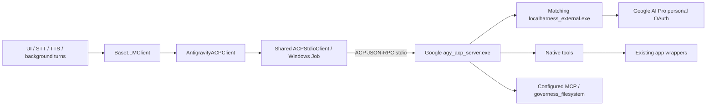

# Antigravity 官方 ACP：實作狀態、操作與歷史評估

歷史評估：2026-10-24。實作狀態更新：2026-10-25，Asia/Taipei。

**目前 working tree 已切換為 Google 官方 `agy_acp_server.exe`，舊 PTY／print backend 已刪除；核心 synthetic E2E 18 steps 與獨立 MEMORY write-back／delta 驗證 6 steps 均通過。** 本文件將目前程式行為與遷移前 feasibility 分開記錄。實際 camera／audio 的整套家庭 UAT 等範圍仍未完成，不宣稱全功能已完全對齊或絕無能力下降。

## 1. 目前決策與實作狀態

| 項目 | 目前行為／狀態 |
| --- | --- |
| 正式模型路徑 | `AntigravityACPClient` → 共用 `ACPStdioClient` → Google 官方 server／matching harness；backend key 保留 `antigravity_cli` |
| 模型範圍 | **使用者已接受 Gemini-only**；不以 Claude／GPT-OSS 缺席阻擋本次遷移 |
| 訂閱限制 | 只准 `oauth-personal`，session metadata 必須確認 `g1-pro-tier`；其他 authentication method、未知 tier、Free／Ultra 等不同 tier 都拒絕，不送模型 prompt |
| API／Cloud | 子程序移除 Google／Gemini keys、ADC、Cloud／Vertex 與 auth-routing overrides；不自動改用 API Key、Cloud 或其他 provider |
| 權限與輸出 | 預設 `mode=yolo`、`auto_approve_scope=once`、`stream_mode=final_segment`；家庭 domain authorization 繼續適用 |
| 共用程式 | OpenCode／Grok／Antigravity 共用 ACP process、JSON-RPC、session、permissions、streaming、取消與相關 hooks；Codex 保持原生 app-server protocol |
| Workspace 與 context | 缺檔才從 public template bootstrap；不覆寫既有 private 文件。首次／換 session／內容變更時，透過 ACP text blocks 載入必要 context |
| 跨 workspace 檔案 | 已加入正式 `governess_filesystem` MCP；預設 scope 是 workspace、目前使用者 home 與 `APP_DIR`。其他路徑要明設 `filesystem_roots` |
| 舊程式清理 | 已刪 `antigravity_cli_client.py`、PTY 專用 tests、latency probe 與 `pywinpty` declaration；沒有 legacy import alias、CLI cache 輪詢或 print fallback |
| 真實驗收 | 本輪正式 client synthetic E2E 18 steps 通過，包含 MCP、public wrappers、工具中取消、refresh／restart-resume 與 cleanup；完整家庭 UAT 的限制見第 7 節 |

驗證 personal Pro 與清除 API routing 可以限制 LLM 的 authentication／計費路徑，但不是逐筆 quota ledger。若還要求不使用額外購買的 AI credits，需在官方帳號設定核對 overages；本程式不把 token 數換算成剩餘訂閱額度，也不宣稱已驗證所有官方 credits 行為。

## 2. 現在的架構與責任



| 檔案／區域 | 實作責任 |
| --- | --- |
| `llm/antigravity_acp_client.py` | 官方 runtime discovery、personal profile／Pro gate、Gemini variant 轉 family＋effort、context blocks、filesystem MCP session parameters |
| `llm/acp_stdio_client.py` | 長連線 process／Job、JSON-RPC futures、new／resume／load／refresh、configOptions、prompt、final segment、keepalive、permissions 與取消；不記 raw protocol payload |
| `llm/workspace_context.py` | 共用 project path resolution 與只補缺檔的 bootstrap |
| `llm/antigravity_runtime.py` | 內建 release 安裝、官方 Registry 最新版本更新、archive SHA256、Google Authenticode、server／helper receipt、原子啟用與 child environment isolation |
| `llm/model_catalog.py` | 透過 protocol 查詢模型，每次切換後讀實際 effort options；查詢 workspace 為 synthetic，不載家庭記憶 |
| `tools/agent_filesystem_mcp.py` | 有明確 roots 的讀文字、讀圖片、列目錄與寫文字；不提供無限制 shell proxy |
| `config.py` | 一次性移除 private `print_timeout`；必要時轉 global 回合 timeout，保留其他 private／未知 keys |
| startup UI | 官方 runtime 安裝／更新、顯式 Google AI Pro 登入、catalog 與正式 backend 準備 |

每次 new／resume／load／refresh 都驗證 tier，並重新套用 model／effort／mode；不能相信 server 恢復時仍保有原設定。不可用的 model／effort 明示失敗，不偷偷選另一個模型。Startup UI 對既存 Gemini variant 做明確 normalization；模型或 effort 未由新 catalog 提供時保留可診斷狀態，不靜默 fallback。Session ID 保持 runtime state，不從 public config 恢復舊 CLI conversation ID。

`yolo` 控制工具 permission；它不會增加模型 entitlement，也不會擴大 Google native file tool 的 workspace boundary。跨目錄需求由正式 MCP 提供，模型推論仍直接走官方 ACP。

## 3. 安裝、登入與設定

從 repository root 執行 `start.bat`／`debug.bat`，在「AI 服務」選擇 Antigravity ACP：

1. 「安裝／更新官方 ACP 並查詢模型」查詢官方 Registry 最新 release，下載並驗證後啟用。已是最新版不重複下載，損壞安裝會修復。
2. 「登入 Google AI Pro 並查詢模型」明確啟動 personal Google OAuth，選擇有 Google AI Pro 訂閱的帳號。
3. 查詢完成後選擇實際回報的 Gemini model／effort，再啟動正式 app。

也可先在 PowerShell 安裝或驗證 runtime；以下命令從 repository root 開始：

```powershell
cd ai_voice_assistant
$env:AI_GOVERNESS_DISABLE_LOGGING = '1'
$env:PYTHONDONTWRITEBYTECODE = '1'
.\venv\Scripts\python.exe -B -m llm.antigravity_runtime install
.\venv\Scripts\python.exe -B -m llm.antigravity_runtime update
.\venv\Scripts\python.exe -B -m llm.antigravity_runtime verify

# 強制重新下載 Registry 最新版本以修復
.\venv\Scripts\python.exe -B -m llm.antigravity_runtime update --repair

# 明確安裝／修復程式內建驗證版本
.\venv\Scripts\python.exe -B -m llm.antigravity_runtime install --repair
```

程式內建驗證版本為 `1.4.3`；2026-10-25 官方 Registry 也仍列為 `1.4.3`。UI 的更新操作會每次查詢 Registry，支援日後的新版本，與一般 `agy update` 的 release track 分開。不同版本存放於 `%LOCALAPPDATA%\AI_Governess\runtimes\antigravity-acp\<version>\`；staging 驗證 archive SHA256、Google signatures 與 matching pair 後，才原子更新 `active.json`，保留其他已安裝版本。更新不自動降版；下載／驗證階段失敗或取消時保留原安裝。更新完成後再取消模型查詢，不會撤銷已完成的更新。

平常啟動不查 Registry，使用已啟用版本與 release receipt 的 binary hashes 進行離線驗證。既有內建 bundle 不需 receipt 也能以內建 hashes 驗證；新版本必須有經 installer 產生的 receipt。手動指定 executable 也適用相同規則。若原先指定舊 executable，更新後的模型查詢會使用新版本；UI 成功後清空該 override、改選受控版本，隨正常 save／start 保存，不會查到新模型卻啟動舊 server。

以下欄位已由正式 client 支援；實際 model／effort 以查詢結果為準：

```json
{
  "llm": {
    "active_backend": "antigravity_cli",
    "antigravity_cli": {
      "project_dir": "./agent_workspace",
      "executable": "",
      "auth_method": "oauth-personal",
      "subscription_only": true,
      "model": "",
      "effort": "",
      "mode": "yolo",
      "auto_approve": true,
      "auto_approve_scope": "once",
      "stream_mode": "final_segment",
      "startup_timeout_seconds": 90,
      "request_timeout_seconds": 120,
      "required_context_files": ["AGENTS.md", "MEMORY.md"],
      "instruction_files": ["TOOLS.md"],
      "mcp_servers": [],
      "filesystem_roots": ["~"]
    }
  }
}
```

`filesystem_roots` 是額外授權目錄，workspace 與 `APP_DIR` 由 app 加入；預設 `~` 提供目前 Windows 使用者 home，涵蓋通常位於 home 的 Desktop／Downloads。若 Desktop 經 OneDrive 轉址或檔案位於其他位置，以 `filesystem_roots` 明確加入實際 task directory。設定此陣列會取代預設的 `~` 清單；若還需要 home，請保留它。

例如可設定 `["~", "D:\\Family\\Homework"]`。目錄必須存在；filesystem MCP **拒絕整個 filesystem volume root**，不能設定 `C:\`／`D:\`，應指定 `D:\Family\Homework` 這類任務目錄。Symlink／junction 解析後仍要落在已授權 roots。MCP 不授予新的家庭任務權限，也不取代 camera consent 或排程確認。

舊 private `llm.antigravity_cli.print_timeout` 在 load 時只於記憶體移除；若 private 未明設 `llm.response_timeout_seconds` 且 duration 有效，轉成相同秒數的 global 回合 timeout。明確 global 設定優先，無效 duration 保留 global default；不拿它當 ACP request／startup timeout。Load 不立即寫檔，下一次正常 save／flush／startup draft save 才保存新 schema，其他 private／未知 keys 保留。

## 4. 能力保留、已補強項目與待驗收範圍

| 類別 | 已實作／已知行為 | 驗收限制 |
| --- | --- | --- |
| 模型 | Gemini family／effort 由 ACP catalog 查詢；舊 Gemini variant 嚴格轉換；Gemini-only 已被接受 | 不承諾未公布的 Claude／GPT-OSS，模型自述不能證明有效 thinking budget |
| 訂閱 | `oauth-personal`＋`g1-pro-tier`，每輪檢查 profile；wrong auth／unknown tier fail closed | 無 API fallback 不等於可逐筆核對官方 baseline quota／AI credits |
| Context | Required AGENTS／MEMORY、instruction `TOOLS.md`、UTF-8、缺檔 bootstrap、初次與變更時載入；初次載入、continuity 與獨立模型 MEMORY write-back／delta 均通過 | 使用新 synthetic fixture，未改家庭真實 MEMORY；完整家庭 UAT 仍需另驗 |
| 跨 workspace | `governess_filesystem` MCP 已接線，預設 workspace＋home＋`APP_DIR`；可明設 task roots | Native file boundary 仍存在；scope 外需求要先設定目錄，並非整台電腦無限制存取 |
| Streaming | 共用 ACP＋`final_segment`，thought／tool activity 轉 keepalive | Raw first chunk 時間不等於 UI／TTS 開始播放；不能把工具旁白當最終回答 |
| Session／取消 | 正式 E2E 已通過真實工具中取消、下一輪、refresh、owned restart-resume 與恢復後 continuity／config | 本次取消 fixture 成功不等於所有工具都能撤銷已發生的 side effects |
| 白板／排程／camera wrappers | Public 白板／排程 wrappers 的回覆與 host state 已驗證；native embedded HTML hide／restore／expiry／Markdown 亦通過 | 未完成真實 camera／audio 整套家庭 UAT；不由這些 checks 推定所有裝置與 GUI 情境 |
| Search／圖片／shell／其他 MCP | 官方 native tools 與 configured MCP 可由 ACP session 使用 | 各能力以真實結果驗收；不由 capability 宣告推定全部通過 |
| Browser／skills／plugins／hooks／subagents | 不以 CLI TUI command 的存在推定 ACP 全部開放 | 未完整驗證的項目維持待驗收，不自動啟用新權限或另一個計費路徑 |

語音 STT／TTS 繼續由愛管家既有 pipeline 處理。它們的 API Key 與 Antigravity LLM 的 personal subscription 是不同服務設定，語音 keys 不會傳入 Antigravity child environment。

## 5. 反應時間與 lifecycle

正式 runtime 後續冷啟動準備約為 **16–18 秒級**，完整 `await ensure_ready()` 的觀察值是 **16.985／17.122／18.414 秒**，包含 initialize、session/new、tier 驗證與 config。這是少量本機觀察，不是 SLA，也不是一般每輪回覆時間。它與 2026-10-24 早期 raw probe 的 `initialize` 21–26 秒、首次 `session/new` 5–8 秒屬於不同批次與測量邊界，不能直接相減宣稱固定加速。

正式 app 在準備完成後保留同一 ACP process，避免每輪重新啟動。Catalog 使用自己的 synthetic workspace 並在查詢後關閉 client；正式家庭 session 另行準備。因此首次模型查詢與 app 啟動可能各有準備成本，不能宣稱兩者已共用同一 process。

歷史短回覆比較中，Flash／low 的舊 PTY 中位數為 15.106 秒、暖機 ACP 為 5.139 秒；Argon／medium 分別為 13.590／5.063 秒，各只有三輪。ACP 仍出現 30.080 秒的慢回合；不保證每輪更快，也不代表 STT＋LLM＋TTS 的總延遲。完整資料及限制見[能力與 latency 文件](antigravity_acp_capabilities_latency_2026-10-24.md)。

正式 E2E 另保留一個 **146.875 秒**的 post-refresh seed 慢回合。原 observer 在 production client 的 session filter 前計數，部分 tool events 可能來自其他 session；因此它不是乾淨的無工具 benchmark，不能用 event count 推算本輪工具數或固定加速比例。

Timeout 分為 startup 90 秒、session／request 120 秒與顯式 OAuth setup 300 秒；模型整輪由 global `llm.response_timeout_seconds` 控制。Keepalive 只能表示活動，不能無限延長總 deadline。

中斷與錯誤不自動重播可能產生 side effects 的 prompt；取消只處理目前 turn／owned Job，不能假設能撤銷已發生的操作。Session restore、refresh、取消後立即下一輪與 process cleanup 都需獨立測試。

## 6. 可重跑的實作驗證

以下 smoke diagnostic 使用正式 `AntigravityACPClient`，建立 temporary synthetic workspace；不讀家庭 config／記憶，也不維護第二套手寫 JSON-RPC transport。輸出只有 metadata、布林驗證與計時，不輸出 session ID、模型文字、tokens、thoughts 或 tool payload。

從 repository root 執行：

```powershell
$env:AI_GOVERNESS_DISABLE_LOGGING = '1'
$env:PYTHONDONTWRITEBYTECODE = '1'
# 只驗證官方 runtime、personal Pro 與 session；不送模型 prompt
.\ai_voice_assistant\venv\Scripts\python.exe -B .\prototypes\antigravity_acp_probe.py

# Synthetic memory marker；會消耗少量訂閱額度
.\ai_voice_assistant\venv\Scripts\python.exe -B .\prototypes\antigravity_acp_probe.py --model gemini-3.8-flash --effort low --smoke

# 只有明確需要登入時才允許 official personal OAuth browser flow
.\ai_voice_assistant\venv\Scripts\python.exe -B .\prototypes\antigravity_acp_probe.py --authenticate --smoke
```

Regression 必須切到 `ai_voice_assistant`，使用專案 venv：

```powershell
cd ai_voice_assistant
$env:AI_GOVERNESS_DISABLE_LOGGING = '1'
$env:PYTHONDONTWRITEBYTECODE = '1'
.\venv\Scripts\python.exe -B -m pytest -q -p no:cacheprovider tests/test_antigravity_acp.py tests/test_antigravity_runtime.py tests/test_agent_filesystem_mcp.py tests/test_llm_clients.py tests/test_config.py tests/test_session_integration.py
.\venv\Scripts\python.exe -B -m pytest -q -p no:cacheprovider

# Native GUI checks：需 interactive Windows desktop，單獨循序執行
$env:AI_GOVERNESS_NATIVE_TESTS = '1'
.\venv\Scripts\python.exe -B -m pytest -q -p no:cacheprovider tests/test_startup_usability.py tests/test_audio_startup.py tests/test_google_credentials.py tests/test_native_session.py
Remove-Item Env:AI_GOVERNESS_NATIVE_TESTS
```

Mock／synthetic tests 檢查拒絕錯誤計費路徑、config restoration、context、roots、permissions、lifecycle 與設定保存；authenticated smoke 檢查供應商實際行為；GUI／語音 UAT 檢查家庭使用流程。三者不能互相替代。

## 7. 正式實作的本輪驗證結果

正式 production client 的 [synthetic E2E record](antigravity_acp_implementation_validation_2026-10-24.json) 已於 2026-10-25 完成本輪 **18 steps，全部 passed**。它與第 8 節歷史 feasibility 分開，使用隔離 fixtures，未操作家庭真實 state。

同一 record 的 `memory_writeback_validation` 另記錄一組**獨立 MEMORY fixture 的 6 steps，全部 passed**；保留「核心 18＋獨立 memory 6」的分組，不把它們當作 24 個去重後的整體情境。

| 項目 | 狀態 | 正式驗證紀錄 |
| --- | --- | --- |
| Startup／Pro／yolo／environment | 通過 | 官方 1.4.3、`g1-pro-tier`、Flash／low／yolo、owned Job、child API keys absent |
| MCP 跨 workspace 讀寫／圖片 | 通過 | 正式 file tools 執行成功，獨立 host 讀回內容；synthetic 圖片辨識通過 |
| Context／continuity | 通過初次讀取與多輪 | Synthetic memory color 與前輪內容斷言成功 |
| 獨立 MEMORY write-back／delta | 6 steps 通過 | `edit_text_file` 恰 1 次，host bytes 等於 initial bytes 的精確 canary replacement，AGENTS 不變且 CRLF 保留；同 session 下一輪 2.963 秒、無 tools，context block 只有 NEW、沒有 OLD |
| Public 白板／排程 wrappers | 通過 | Exact control reply 加 host receipt／state：Markdown、圖片、hide／restore／close、HTML path／quota guard、schedule draft／confirm／delete、簡單提醒、undo 與 report body guard |
| 工具中取消／下一輪 | 通過 | Host 確認 30 秒 fixture 已開始後送 cancel，0.015 秒回 cancelled；至少 35 秒後仍無 completion marker；下一輪 3.312 秒成功 |
| Refresh／owned restart-resume | 通過 | 新 session 與 config 確認；重啟後同 session 恢復 15.003 秒，恢復後 continuity 回合 4.900 秒 |
| Owned process cleanup | 通過 | Job／reader／stderr tasks 清空，host 查無本輪 server processes |
| Registry 更新 → 模型查詢 | 通過 | 2026-10-25 真實官方 Registry／server 流程 17.140 秒；已是 `1.4.3` 時不重複下載，取得兩種 Gemini family 的 low／medium／high；未送模型 prompt |
| 全套 regression | 通過 | **1223 passed、31 skipped、3 warnings，33.34 秒**；含 Registry future-release、更新失敗保留原版本、離線 discovery 與串流取消 regressions |
| Native runtime UI subset | 通過 | **45 passed，6.80 秒**；含真正的安裝／更新按鈕與受控版本選擇保存 |
| Native startup／audio／credentials 與 embedded 白板 | 通過本輪範圍 | **72 passed，61.29 秒**；包含真實 embedded HTML hide／restore／expiry／Markdown |

多次 pytest 的 subsets 有重疊，**不能將上述 passed 數相加**。Native audio／credentials 測試通過也不代表已完成真實收音、camera、STT→LLM→TTS 的整套家庭 UAT。

MEMORY 驗證第一次 fixture 的 expected bytes 誤以 LF 比對，實際 CRLF 檔案並未被破壞；該次保留於 attempts 記錄，屬測試預期修正，不算產品失敗，也沒有自動重播 side effects。後續使用獨立新 fixture，以 initial bytes 的精確 replacement 驗證通過。

尚未完成真實 camera／audio 的整套家庭操作；Browser／skills／plugins／hooks／subagents 等未完整驗證項目亦不能宣稱已全部等價。上述結果確認本輪測試範圍通過，不宣稱全功能對齊或絕無下降。

## 8. 2026-10-24 feasibility 與歷史證據

以下是遷移前的實驗快照，**不是目前 working tree 尚在使用舊 client 的描述，也不是正式 client E2E 的替代證據**。去識別化 raw record 保留於 [antigravity_acp_probe_2026-10-24.json](antigravity_acp_probe_2026-10-24.json)。

- 舊 CLI `1.4.6` 使用每輪 ConPTY／`agy -p`、ANSI 清理及 CLI conversation cache；這些 production code 已移除。
- 官方 ACP `1.4.3`，protocol 1；Windows x64 ZIP 為 131,267,135 bytes，archive SHA256 為 `54c2e16378d9a4952e1da70e355f3c33c4f284308d6de48ab3e6e34a127bd325`。
- 官方 server 87,022,872 bytes、helper 147,843,736 bytes；當時皆為 Valid Google LLC Authenticode。實驗安裝位置在 `%LOCALAPPDATA%\AI_Governess\experiments\antigravity-acp\1.4.3\`，與目前受控 `runtimes` 位置分開。
- 使用者完成 personal OAuth，確認與舊 CLI 是同一 Google 帳號；報告未保存 email／tokens。Child environment 沒有 Google API／Cloud keys，authenticate 與 session 都回報 `g1-pro-tier`。
- Synthetic AGENTS／MEMORY、讀寫／shell、Gemini 切換、yolo、web search、image block、stdio MCP、多輪、取消及 restart／resume 的歷史 checks 通過；詳細斷言、額外 failed tool event 與限制完整保留於 raw record。
- Native file tool 對同一 sibling fixture 回 `ACCESS_DENIED`，舊 CLI 可讀；yolo 沒有解除 boundary。目前以 app-owned filesystem MCP 補強 task roots。
- 歷史 whiteboard show-markdown 只確認 manager state，schedule 只確認 list；它們不能代表正式 GUI、quota、排程確認／undo 已通過。
- 同帳號 ACP 拒絕 Claude，GPT-OSS 不在 catalog；使用者接受 Gemini-only。Default／yolo 都拒絕 Claude，因此不由工具 permission 推論模型 entitlement。
- 早期 initialize 21–26 秒、session/new 5–8 秒、帶 stdio MCP 的 session setup 單次 41.981 秒、resume 7.858 秒、load 43.970 秒；都是少量歷史觀察。
- 恢復後 effort 曾由 low 回 high；這促成正式 client 每次 setup 重新設定的設計。

原始手寫 ACP feasibility transport 與依賴舊 client 的 latency probe 已刪除；本文件、raw record 與 latency 數據保留。需要重現舊 baseline 時，可從遷移前 Git revision 取得舊 production client，依記錄的方法重新量測。

## 9. 歷史來源與驗收原則

下列連結是評估時引用的官方來源；版本／entitlement 具有時效性，更新以當下官方 Registry、下載與簽章驗證及實際 server negotiation 為準，不能把歷史網頁快照當成永久支援保證。

- [官方 ACP Registry entry](https://github.com/agentclientprotocol/registry/blob/main/antigravity-acp/agent.json)、[Google authentication](https://antigravity.google/docs/install/)、[plans](https://antigravity.google/docs/plans)、[CLI credits](https://antigravity.google/docs/cli/credits/)。
- [ACP v1 overview](https://agentclientprotocol.com/protocol/v1/overview)、[session setup](https://agentclientprotocol.com/protocol/v1/session-setup)、[config options](https://agentclientprotocol.com/protocol/v1/session-config-options)。
- [官方 workspace boundary issue #1273](https://github.com/google-antigravity/antigravity-cli/issues/1273)、[effort observation issue #1307](https://github.com/google-antigravity/antigravity-cli/issues/1307)。
- [Google MCP](https://antigravity.google/docs/mcp/)、[skills](https://antigravity.google/docs/skills/)、[plugins](https://antigravity.google/docs/plugins/)、[subagents](https://antigravity.google/docs/subagents/)；CLI 產品文件不能直接證明 ACP 同版本的完整能力。

驗收與後續回歸持續涵蓋：訂閱拒絕路徑、Gemini model／effort、private context 與 memory write-back、帶 host state 的工具結果、取消與 session isolation、背景只讀／確認規則、Windows process ownership、安裝失敗恢復，以及 GUI／語音 UAT。Gemini-only 是已接受的例外；其他未驗證項目不以自然語言回答或 capability 宣告代替測試。
