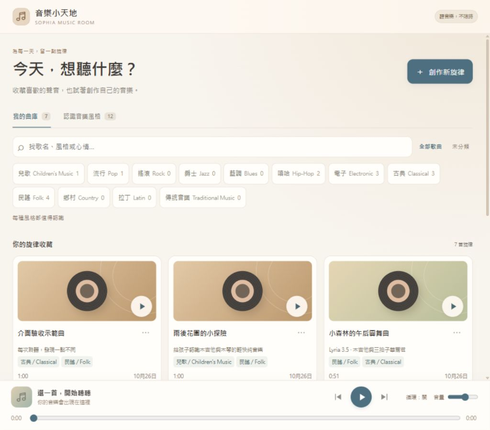

# 音樂小天地

主畫面右側「對話」標題旁的音符圖示可開啟曲庫。也可以直接對愛管家說「播放民謠」「下一首」「音量小一點」或「創作一首溫暖的木吉他音樂」。

## 開始使用

1. 初始設定「AI 服務」中的「Gemini API CLI 與音樂」，按「安裝／更新 CLI」。
2. 設定共用的 Google API key，按「查詢可用模型」確認帳戶可用模型；所有音樂固定選擇 `lyria-3.5`。
3. 儲存並啟動，按音符圖示。已有歌曲不需 key，也不需連網即可播放。

「創作新旋律」可填名稱、風格、聲音描述、大約長度，以及純音樂／有人唱歌。唱歌可選填原創歌詞；留白時由模型創作。提交後在背景處理，可以繼續聊天；完成後歌曲自動加入曲庫，主畫面顯示通知。生成完成不會取代正在使用的其他白板。

每首使用 Lyria 3.5，預估 US$0.08，實際計費以 Google 為準。初始設定進階搜尋 `music` 可設定每天次數、預估費用、容量與逾時；預設每日 10 次、US$0.80、2 GiB。已取消、失敗或結果未知的提交也保守計入當日上限。這是 app 本機的控制，不是 Google Billing 預算。

## 聽音樂與認識風格

曲庫提供播放／暫停、上一首／下一首、拖曳進度、音量，以及單曲／曲庫循環。下一首依目前篩選結果挑選。每張卡片的「⋯」可修改名稱與風格，不會重新生成。

「⋯」內的「刪除這首歌」會先顯示確認視窗，再移到「回收區」。刪除播放中的歌曲會停播；回收區按「恢復歌曲」就能找回原音檔、ID、名稱與分類，不重新生成。回收區仍占用本機容量，這個版本不提供永久清空。

播放器音量與 app 降音量／靜音分開計算：實際音量是使用者滑桿值乘上 app 的音量比例。例：滑桿 35%、說話時比例 20%，實際為 7%；恢復後回到 35%。在靜音時調整滑桿也會保留新選擇，取消靜音後生效。

本機已為 12 種大風格各準備至少一首單一分類的入門示範，所有新增音樂均由 Lyria 3.5 創作。搜尋「風格入門」可集中查看。這些歌曲只留在本機，不隨程式碼上傳 GitHub；新安裝不會自動下載歌曲或發出付費生成。

12 種雙語大風格在空曲庫也完整顯示，並在「認識音樂風格」提供一句簡介：

| 中文 | English | 穩定 ID |
|---|---|---|
| 兒歌 | Children's Music | `children` |
| 流行 | Pop | `pop` |
| 搖滾 | Rock | `rock` |
| 爵士 | Jazz | `jazz` |
| 藍調 | Blues | `blues` |
| 嘻哈 | Hip-Hop | `hip-hop` |
| 電子 | Electronic | `electronic` |
| 古典 | Classical | `classical` |
| 民謠 | Folk | `folk` |
| 鄉村 | Country | `country` |
| 拉丁 | Latin | `latin` |
| 傳統音樂 | Traditional Music | `traditional` |

一首歌可屬於多種風格。多選時預設符合**任一**風格；勾選「同時具有這些風格」則必須全部符合。歌曲不會重複顯示，風格旁的數字各自計數，所以不同風格的數字相加可能超過總曲數。搜尋支援名稱、中英風格、細節與標籤；沒有分類的歌可選「未分類」。

播放器不計入 HTML 每日時間；HTML 額度停用、用完或紀錄故障仍可使用。一般互動遊戲維持原來的限制。隱藏、關閉或換成其他白板會停播；重新開啟與重新載入保持暫停，避免突然出聲。瀏覽器若要求使用者手勢，按一次播放即可。

愛管家說話或開始收音時，音樂會自動降低音量；白板標題列可整體靜音。音樂使用內嵌 Edge 的系統音訊輸出，與 Python TTS 的指定輸出裝置不同。

## 曲庫保存與故障處理

預設資料夾是 `ai_voice_assistant/music_library/`：正式音檔在 `tracks/`、metadata 在 `metadata/`，SQLite 保存曲庫索引、工作與播放回報。容量計算涵蓋資料庫、音檔、metadata 與未確認工作的暫存。這些內容均為本機 private data，不進 Git。備份時先關閉 app，再備份整個資料夾。

- 找不到音檔：仍保留歌曲紀錄並標示不可播放，不擅自重生成；可從備份還原。
- 生成取消：取消尚未送出的工作；已送到 Google 的請求可能仍計費。
- 結果未知／程式中斷：不自動重新提交付費請求。可能有用的暫存留在 `staging/<job_id>/`；需確認音檔後才手動匯入。錯誤通知可按「收起」，不刪除工作紀錄。
- 曲庫滿額：保留所有歌曲並停止新增，不自動刪歌。可由家長調整設定或備份搬移曲庫。
- Edge 啟動失敗：重新載入或重啟 app；agent 不應把已開白板誤說為實際播放。

長度、指定風格、是否無人聲與歌詞逐字正確都是創作要求，模型不保證精準遵守；分類可在試聽後修正。程式只驗證音檔可解碼、有聲音及格式／容量限制，不冒充真人的品質鑑定。

## AI agent 操作

app 每個一般使用者回合會提供音樂能力、canonical tool 路徑、payload 目錄及精簡流程，涵蓋 Codex、Claude Code、OpenCode、Grok、Antigravity。舊 private `AGENTS.md`／`TOOLS.md` 不會被覆寫。新 workspace 的 template 也有工具索引。

完整工具契約與範例見 [Music tools v1](../ai_voice_assistant/tools/music/USAGE.md)。流程是 `capabilities/styles → generate → job-status`，或 `list → show-player → player-status → player-control → player-status --command-id`。

生成的 `queued/running/validating` 不能說成完成。控制指令的 `accepted` 不能說成已播放；必須核對相同 `command_id` 的 ack，且最新 `playback_state=playing` 才能說播放器回報播放中。這仍不是喇叭實際聲音的證明。

## 畫面

以下為隔離驗收曲庫的桌面畫面，包含一首以錄製音訊驗證 UI 流程的示範曲；正式曲庫沒有這首測試資料。

