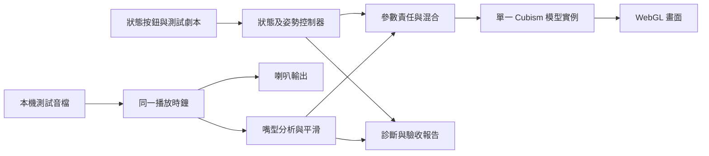

# 愛管家單一 Live2D 模型獨立驗證規劃書

版本：1.3｜更新：2026-11-12｜階段：G1 基礎相容性與音訊嘴型已實作；目前進行 G2 原圖五官與手部精修，完整手勢與質感尚未驗收。實際進度見 [G1 紀錄](reports/g1/STATUS.md) 與 [G2 紀錄](reports/g2/STATUS.md)。

## 1. 預期成果與範圍

交付一套可在 Windows 本機獨立啟動的角色展示工具：啟動後只載入一個愛管家 Live2D 模型，即可展示現有全部狀態、主要手勢、自然微動與音訊同步嘴型。使用者確認角色外觀、動作及聲畫同步達標後，才考慮整合進愛管家。

本階段包含角色素材整理、部件補畫、rigging、動作製作、獨立播放器、測試與錄影。正式助理的 UI、TTS、收音、狀態機與設定整合屬於下一階段，不列為本次完成條件。

**可延伸性是本次模型驗收的一部分。**現有五狀態、七姿勢與 30 張影格是最低能力測試，不能成為模型的能力上限。目標是可透過獨立控制與動作曲線組合出更多表情、手勢的角色 rig。現有姿勢即使全部能重現，若新增一般表情仍須重新畫整張臉、或每個新組合都要重做模型，仍不算通過。

**單一模型的操作定義：**同一份 `.model3.json` 指向同一份 `.moc3`，在同一次展示中建立一個模型實例；切換狀態時更新參數、motion、expression 或模型內的部件顯示，不重新載入另一個角色。允許同一模型包含多套手掌、手臂與衣袖差分，也允許多張 texture atlas；不以五個完整人物模型或整張人物影格替換來達成驗收。

**頭部結構補充：**各表情共用頭部底圖，以乾淨分層、局部網格及變形器實現表情。眉眼與嘴部不得夾帶其他來源影格的髮絲或下巴輪廓。每表情替換整個頭部底層的試驗已否決；原圖比對用來校準表情特徵與位置，不能以大量頭部貼圖替代正確 rigging。

「全部動作」以本次盤點的 30 張影格與七種主要姿勢為基線：保留姿勢語意、表情與小動作，將影格間跳動改成連續動畫。依最新要求，各表情五官及手指位置須與原圖幾乎一致，尤其不得鏡像、錯置或削掉拇指。原圖之間的臉形與位置差異需列出並處理，不再自行排除於驗收之外；任何有意刪除的動作必須記錄並經使用者確認。

## 2. 已確認的現況

來源為 `ai_voice_assistant/assets/states/layers/`，共 30 張人物 PNG 與一張背景。已逐列檢視聯絡表；完整清冊見 `references/inventory.json`，盤點縮圖見 `references/current_states.jpg`。以下左右以觀眾視角描述，正式部件 ID 一律以角色自身左右命名。

| 狀態 | 影格數 | 已見姿勢與變化 | 目標資產 |
|---|---:|---|---|
| IDLE_LISTEN | 10 | 雙手交握於腰前、眨眼、細微頭身變化 | idle entry / loop / exit |
| COLLECTING | 4 | 畫面左側手靠耳邊，另一手垂下，專注聆聽 | listen entry / loop / exit |
| SENDING | 5 | 手指靠下巴，另一臂橫於腹前，視線與閉眼變化 | think entry / loop / exit |
| SPEAKING | 8 | 舉食指（1、2、5、6）、手靠胸前（3、4）、攤掌（7、8），伴隨張嘴 | 三種說話 gesture 與共同 speak loop |
| HOT_LISTEN | 3 | 雙手合於胸前、頭部微偏，等待回應 | attentive entry / loop / exit |

現有 `layers` 是背景／完整人物分離，不是眼、嘴、手臂等可動部件分離。現有 `AnimationController` 依狀態換影格，`AudioPlayer` 以 sounddevice 輸出 PCM；可作為日後對接參考，本次展示不依賴這兩個模組。

原圖的待機與說話素材已呈現不同手臂遮擋。最難的部分是肩、袖口、肘、手掌與胸前的前後關係，應早於全套動作驗證。

## 3. 技術方向與選型決策

**交付格式先固定為標準 Cubism 模型；製作端優先試驗開源 PSD2Live，必要時在 Cubism Editor 精修。** 這保留開源自動 rigging 的效率，也用實際目標 runtime 檢查交付品質。

PSD2Live 官方專案說明支援由分層 PSD 產生網格、變形器、物理與動作，並匯出 `.moc3`、`.cmo3`。本次已用 3.6.7 實測愛管家拆件 PSD：匯出成功，moc3 可由官方 Core 載入並控制嘴型；cmo3 在 Cubism Editor 的可編輯性及高風險手勢仍待驗證。通過完整 G1 後才擴大使用。完整比較見 [OPEN_SOURCE_RIGGING.md](OPEN_SOURCE_RIGGING.md)。

主路線：

```text
現有角色與姿勢參考
 → 同一基準設計的分層 PSD ＋ 必要姿勢差分
 → PSD2Live 生成基礎 rig ＋ 編輯修整
 → 在 Cubism Editor / 官方 runtime 檢查輸出
 → 一個 moc3 ＋ motions / expressions / physics / pose
 → 獨立 Cubism SDK for Web 展示工具
 → 質感驗收與是否整合的決定
```

See-through 僅用於輔助拆圖、補出遮擋區域；每個部件仍需人工／視覺校對。AI 生成並不保證像素位置與角色一致，應以局部修圖與原圖對齊處理。Anime2.5DRig 可作快速外觀預覽對照，但其自有格式不作標準 Live2D 交付依據。[See-through](https://github.com/shitagaki-lab/see-through)、[Anime2.5DRig](https://github.com/852wa/Anime2.5DRig)

## 4. 獨立資料夾與交付結構

以下為完整交付的預定結構；G1 實際檔案包含 viewer、tools、tests、models 與 reports，請以 README 及 G1 紀錄為準，尚未建立的完整動畫交付物仍列為後續工作。

```text
prototypes/live2d_character_lab/
  README.md / PLAN.md / OPEN_SOURCE_RIGGING.md / ACCEPTANCE.md
  references/                   # 現況清冊、縮圖、姿勢對照
  design/                       # 拆件規格、角色與手勢設計、修改紀錄
  authoring/                    # PSD、psd2live、cmo3 原始工程與版本
  models/governess/              # 一個正式候選 runtime 模型包
  viewer/                       # TypeScript、HTML、CSS、Cubism Web adapter
  fixtures/audio/               # 專用測試語音與來源說明
  fixtures/scenarios/           # 五狀態流程與 20 種跨狀態轉換
  tools/                        # 模型校驗、測試與報告腳本
  reports/<candidate-id>/        # 指標、截圖、錄影、問題與評分
  vendor/                       # 取得並固定版本的外部 dependencies
  start_demo.ps1                # 本機建置／啟動入口（待實作）
  package.json / package-lock.json
  .gitignore / THIRD_PARTY_NOTICES.md
```

所有輸出限定在實驗資料夾；下載、快取與 dependency 不寫入主程式 venv。素材以唯讀複本或明確匯入方式建立基線，展示成功後應可將整個 lab 移到其他位置啟動，不依賴上層 Python app。

大型製作工程、錄影、下載工具、授權 SDK 與暫存的 Git 策略在實作時設定；保留原始工程的獨立備份，gitignored 不代表已備份。文件、程式、測試、來源與版本紀錄應可追蹤；模型資產依體積與素材授權選用 Git LFS 或另行封存。

## 5. 同一角色的美術與拆件規格

基準外觀採現有待機角色：棕色短髮、耳飾、淺藍外套、淺色裙裝、成熟親切的形象。先鎖定臉部比例、髮際線、眼睛、肩寬、服裝剪裁與角色位置，所有姿勢沿用同一套比例。

| 部位 | 至少準備的內容 | 必查問題 |
|---|---|---|
| 臉、耳、頸 | 臉底、耳、頸，遮擋區補齊 | 偏頭露洞、下巴與脖子斷開 |
| 眼睛 | 左右眼白、虹膜、上眼瞼／睫毛、閉眼差分 | 眼白漏出、閉眼雙線、眼球越界 |
| 眉毛 | 左右分離 | 過度誇張、與瀏海遮擋錯誤 |
| 嘴巴 | 閉嘴、口腔、牙齒／舌頭或可用的整體口內素材 | 嘴旁膚色貼片、下巴重影 |
| 頭髮、耳飾 | 前／側／後髮，必要髮束與耳飾分開 | 邊緣雜色、動時裂縫、物理過強 |
| 軀幹、衣服 | 頸下完整身體、外套、衣領、裙裝 | 手移開後露洞、衣領伸縮 |
| 上臂、前臂、衣袖 | 左右分開，關節補足重疊區 | 肘部折紙感、袖口與手分離 |
| 手掌差分 | 放鬆、交握、靠耳、托腮、指示、胸前、攤掌、雙手相合所需組合 | 手指變形、比例不一致、遮擋錯誤 |

手勢素材允許局部差分；全身共用臉與軀幹。每一差分標明所屬部件、角色側別、繪製順序、切換範圍及依賴姿態。臉前、胸前與腹前的手需分別設計 draw order，不能用全域固定圖層順序解決所有遮擋。

先以小幅頭部活動為範圍，不增加大角度轉身、背面或全身行走。所有工作圖先維持不低於現有有效細節的來源解析度；atlas 尺寸由實際展示尺寸和部件數決定，不先以放大倍率宣稱畫質改善。

## 6. 單模型 rig 與動畫製作

Live2D 的 rigging 主要包含網格、變形器、參數與 keyform。骨架／IK 可以是製作輔助；若交付 Cubism，須確認它們匯出後的變形結果。

預定控制群：

| 控制群 | 用途 | 擁有者 |
|---|---|---|
| Angle X/Y/Z、Body Angle、Breath | 頭身角度與呼吸 | 基礎動作／小幅程序動畫 |
| Eye Open、EyeBall、Brow | 眨眼、視線、專注與思考表情 | 表情與眨眼控制器 |
| Mouth Open / Mouth Form | 音量開合與嘴形／笑意 | 嘴型控制器，表情僅可影響核准維度 |
| Arm Pose / Hand Variant | 七種姿勢與局部手掌切換 | 姿勢轉換器 |
| Hair / Accessory Physics | 頭髮與耳飾慣性 | 物理系統 |

實際 ID、值域與責任表由模型匯出後寫入 `design/parameter_contract.json`；上表的 Arm Pose / Hand Variant 是設計群名，不宣稱為 SDK 內建參數。

### 可重用控制與能力邊界

以下為正式 rig 的製作要求，尚未由目前端點比對模型實現：

- 臉部控制分離：左右眼開合與視線、左右眉高度／角度／形狀、嘴開合與嘴形、頭部角度可各自調整。表情 preset 記錄這些控制的組合，不以原始影格編號作為正式表情介面。
- 手臂控制分離：左右肩、肘、腕的可動範圍與手掌朝向明確記錄；局部手掌差分附帶側別、拇指方向、接合位置與適用角度。手掌不能永遠綁死在某一個表情或狀態上。
- 狀態、表情、手勢、音訊嘴型分開驅動。例如同一個舉食指動作可搭配微笑、專注或疑問；同一表情可在手勢途中繼續說話。共享參數有明確混合與優先規則，不讓後寫入者任意蓋掉其他控制。
- 在已驗證的角度、姿勢與部件範圍內，新動作應以新增參數曲線／motion／preset 完成，沿用相同 moc3 與 textures。需修模型才能完成時，記錄為能力缺口並重新驗證，不能當作原版本已支援。
- 模型不預先宣稱支援任意轉身或任意手形。新的掌背視角、遮擋區或超出既定角度的動作，可能需要補畫與擴充 rig；記錄原因、影響部件與既有動作的回歸結果。這類局部擴充不得退回整頭／整人換圖。

每個參數須記錄「單獨可動範圍」與「已驗證的組合範圍」；單軸正常不代表多軸極值同時作用也正常。原圖還原與新組合演繹是兩道獨立門檻，不能互相抵銷。

每種狀態製作 entry、loop、exit；SPEAKING 含三種 gesture。說話時的手勢採確定可重播的排程，避免每個字就換一次。嘴巴動畫不烘焙在完整身體 motion 裡，避免語音暫停後仍張嘴。

**轉場策略：**先共用安全過渡姿態，讓手離開臉部或胸前遮擋區，再切換局部差分，最後到達目標姿勢。差分淡入淡出只在輪廓相近的位置使用；直接把兩隻位置不同的手互相淡化會造成重影，不列為合格轉場。Cubism Pose 可管理部件顯示，但自然的中間動作仍需製作。[官方 Pose 文件](https://docs.live2d.com/en/cubism-sdk-manual/pose/)

新狀態到達時以當前可見姿勢作起點，取消舊轉場的後續事件；重複相同狀態不重播 entry。所有 5×4＝20 種跨狀態切換都須有可用路徑。中途打斷說話時先停止嘴型及說話 gesture，身體可用短時間安全回復，而非瞬間回正。

## 7. 獨立展示工具

使用 TypeScript + Cubism SDK for Web + WebGL，在 Edge／Chrome 的 localhost 頁面展示。先不嵌入 Tk；瀏覽器視窗就能完成完整驗收。固定 dependency 版本及模型目標格式，首次取得工具後，runtime 資產全部從本機供應。

展示介面應提供：五種狀態按鈕、七種姿勢展示、完整流程播放、音檔匯入／播放／暫停／停止／靜音／打斷、轉場速度與慢速檢查、原圖對照、淺／深／棋盤背景、原場景背景、視窗尺寸選擇，以及診斷開關。

診斷應可查看當前 state、gesture、嘴巴值、播放時間、FPS、模型載入次數與資產版本。使用者觀看模式隱藏技術資訊，僅顯示角色與基本操作。



原型內部介面草案為 `setState(state)`、`playGesture(id)`、`playAudio(buffer)`、`stopAudio(reason)`、`reset()`。狀態與音訊各自攜帶 sequence/generation，舊播放回呼不得重新啟動已停止的嘴型。這只是日後對接邊界，當前不接主程式事件。

## 8. 音訊與嘴型同步

第一版以 RMS 音量驅動連續嘴巴開合；輸入為實際播放的測試音訊。由同一 Web Audio 播放時間軸取得／索引音量包絡，進行 noise gate、增益限制與 attack/release 平滑。可先預計算音檔 envelope，按播放位置查表，避免計時器累積漂移。

首輪調參值：分析視窗 20–40 ms、attack 30–60 ms、release 60–120 ms，皆為起始設計值而非量測結果。視覺更新隨 render loop 內插。硬體輸出延遲與畫面延遲須量測，再提供校正 offset。

必須處理開始前空白、句中停頓、結尾靜音、暫停／續播、靜音、重播、快速換音檔、打斷及背景頁恢復；暫停和停止時取消舊包絡更新。靜音測試預設閉嘴，另外的純嘴型展示模式明確標示。

音量控制滿足「跟著說話動嘴」；不宣稱逐音素精準。較自然的 A/I/U/E/O 嘴形與 MotionSync 列為第二輪提升，須先備齊模型嘴形，再評估中文與中英混讀效果。[官方 Lip-sync](https://docs.live2d.com/en/cubism-sdk-manual/lipsync/)、[MotionSync](https://docs.live2d.com/en/cubism-editor-manual/motion-sync/)

測試語音使用獨立新建的中性內容，保存用途與來源；不讀取正式 voice_profiles 或 audio archive。素材至少包含短句、20–30 秒長句、中英混讀、有長停頓的句子、低音量與較快語速。原型接受檔案即可，不需要線上 TTS key。

## 9. 分階段工作與交付門檻

以下為製作與工程工作量估算，非承諾日期；假設一位實作者可處理前端與基本建模，且能取得局部補畫支援。人工精修能力不足時，日程需重新估算。

| 階段 | 工作 | 交付與通過條件 | 預估人日 |
|---|---|---|---:|
| G0 現況與規劃 | 清冊、需求、工具比較、驗收方法 | 本文件包；實作尚未開始 | 本次已完成 |
| G1 工具與高風險試驗 | 固定 PSD2Live 版本；樣本匯出；愛管家頭部及托腮→舉食指試驗 | 官方 runtime 可讀、工程可回編，轉場無重大破圖 | 2–4 |
| G2 素材與模型 | 全部部件、七姿勢差分、頭眼嘴 rig、物理 | 一個模型；角色一致、所有姿勢可擺出 | 5–10 |
| G3 動作與展示 | 五狀態 motion、20 轉場、音訊、獨立控制台 | 可獨立重播全部驗收流程 | 4–7 |
| G4 視覺精修與測試 | 接縫、手勢、嘴型、效能、錄影 | 完整報告；重大缺陷歸零 | 4–8 |
| G5 質感審查 | 使用者觀看候選版本、評分與修訂紀錄 | 使用者接受該版本；可開始討論整合 | 1–2 |

合計初估 16–31 人日，可能因素材返工增加；其中 G1 是優先執行的限時試驗。G1 不過便改採 Cubism Editor 製作同一標準模型，保留可用 PSD 與局部工程。不要為通過試驗而把交付格式改成其他 runtime。

各階段可反覆修正，但早期基本嘴型 Demo 不等同於「所有動作完成」。G5 前須取得五狀態、七姿勢及轉場的完整證據。若主觀質感未過，留在 G2–G4 修正，不開始正式整合。

## 10. 驗收標準與測試範圍

以下都是預定目標，沒有已通過的效能或品質數據。執行表見 [ACCEPTANCE.md](ACCEPTANCE.md)。

| 項目 | 通過標準 | 驗證方法 |
|---|---|---|
| 單一模型 | 完整流程僅一個 moc3 身分與實例，切換不重新載入 | asset hash、載入計數與 runtime 記錄 |
| 動作覆蓋 | 五狀態、七姿勢、20 跨狀態轉場全部可展示 | 與現有 30 影格逐項對照 |
| 可延伸性 | 同一候選模型能演出未直接照原圖製作的表情／手勢組合，且音訊嘴型可獨立運作 | 凍結模型 hash 後新增測試 motion；執行 ACCEPTANCE 的 E01–E07，保存曲線與連續錄影 |
| 視覺完整 | 臉形穩定；無缺件、露洞、明顯接縫、重複手掌或嘴部貼片 | 原場景與深／淺／棋盤背景，正常速度與慢速 |
| 嘴型 | 有聲時動嘴、停頓閉嘴；延遲校正後偏移絕對值目標 ≤100 ms | 測試脈衝／音節、同步錄音錄影，標註設備延遲 |
| 停止與打斷 | 停止事件後 150 ms 內嘴巴回到閉合範圍，舊事件不重開 | 事件 timestamp＋畫面記錄 |
| 效能 | 前景 30 fps 模式 p95 frame interval ≤40 ms；目標可選 60 fps | 固定設備、瀏覽器、DPI、渲染尺寸，暖機後連續 5 分鐘 |
| 長時間穩定 | 30 分鐘無崩潰；20 次完整流程後無模型／音訊資源持續累積 | 記憶體趨勢、資源數、事件記錄 |
| 獨立性 | 正式愛管家未啟動仍可使用；移動 lab 後路徑有效 | 第二位置啟動、離線 runtime 測試 |
| 使用者質感 | 下述六項每項至少 4/5，且使用者明確接受 | 具版本號的評分表 |

質感六項：角色相似度、頭眼嘴自然度、手勢自然度、姿勢轉場、聲畫同步、長時間觀看舒適度。平均分不能抵銷任何單項不合格。破臉、重複肢體、手穿臉、長時間嘴型漂移均為阻擋缺陷。

展示尺寸至少測試 320、640、960 CSS px 的方形舞台與橫向視窗，記錄 devicePixelRatio 和實際繪圖 buffer 尺寸；人物保持比例與手勢完整，不把張開的手裁掉。原生 Windows UI 的 DPI、全螢幕與焦點行為留待整合階段驗證，不以瀏覽器通過代替。

## 11. 依賴、成本與操作安排

製作工具優先使用獨立便攜安裝或專屬環境。PSD2Live／See-through／Web viewer 的版本分別固定，保存 commit 或 release、下載來源與雜湊；不自動跟隨 upstream 更新。See-through 若本機 GPU 不合適，可另行選擇拆圖工具或手工拆件；本機推論速度尚未測量。

主要成本是原畫補件、手部差分與反覆 rigging 精修，開源工具不代表免除這些工作。金額需依 G1 發現的修圖量估算，現階段不提供未核實報價，也不執行付費訂閱。

Cubism FREE 官方目前限制最多 100 ArtMesh、30 個 motion parameters，另有 texture 等限制；七種手勢的模型是否能放入，須以實際部件表判斷，不預先保證 FREE 足夠。[官方 FREE / PRO 比較](https://www.live2d.com/en/cubism/comparison/)

PSD2Live 編輯器與 runtime 授權分開記錄；僅把它用作製作工具，不因此將其整套程式嵌入愛管家。素材、模型、SDK 與工具各保留自己的授權說明；標準 Cubism runtime 的取得與散布條件另依官方文件確認。[SDK 發布授權](https://www.live2d.com/en/sdk/license/)

## 12. 主要風險與回復方式

| 風險 | 最早驗證點 | 處理方式 |
|---|---|---|
| 自動 rig 只能微動，無法完成手勢 | G1 托腮→舉食指 | 補局部差分與過渡姿態，改以編輯器精修 |
| 匯出成功但 Cubism 播放不一致 | G1 official runtime 對照 | 檢查 loss report，減少不支援特性，必要時官方重綁 |
| AI 補畫改變人物外觀 | G2 對齊基準圖 | 局部補畫、同一基準臉，拒收整體換臉版本 |
| 手勢切換雙影／穿模 | G1、G3 慢速回放 | 在接近姿態換差分，補中間動作與 draw order |
| 嘴型與表情互相覆寫 | G3 同時說話／微笑 | 明定參數責任，音訊擁有口開合，清除 stale generation |
| 幀率與記憶體不合格 | G3 起即量測 | 限制網格／atlas、重用資源，保留明確 30 fps 模式 |
| 工具更新破壞工程 | 每次工具變更 | 固定版本、保存源工程、每版重新跑匯出檢查 |
| 樣本很美但愛管家未過關 | G1 使用自有高風險素材 | 樣本僅證明工具可用，正式評分只評愛管家 |

## 13. 完成條件與整合決策

候選交付包須包含：來源 PSD、可編輯 rig 工程、單一 runtime 模型、全部 motion／expression／physics／pose 資料、可重建的 viewer、測試音檔、版本清單、完整示範錄影與驗收表。保留已知限制和未解問題，不能以檔案生成成功宣告質感完成。

整合前的決策紀錄由使用者確認候選版本：`接受並討論整合`、`修正後再看` 或 `保留原方案`。通過原型只代表可進入整合規劃；不自動修改主程式。屆時另評估既有 Edge host、Python PCM 到嘴型的資料傳遞、實際播放時鐘、打斷同步、DPI／全螢幕和回退機制。

本規劃使用的影片資料為章節、說明與作者同篇教學，未取得逐字字幕；工具結論以原始專案文件及官方 SDK 文件補充。影片來源：[YouTube](https://www.youtube.com/watch?v=KOuwb96iSW4)、[作者教學](https://miaainow.com/zh/ai-live2d/)。
